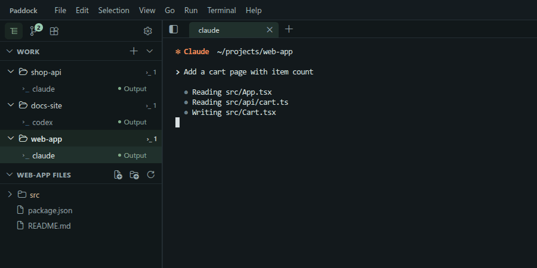

# Paddock settings and details

Open settings with `Ctrl+,` (macOS `Cmd+,`) and search for `paddock`.

- **Agent permission prompts** (`paddock.agents.permissions`): how Claude and Codex started from **Accounts** handle permission prompts. `ask` (default) asks before each tool use. `allowSkip` lets Claude switch to skipping prompts inside the session with Shift+Tab. `skip` starts Claude with `--dangerously-skip-permissions` and Codex with `--dangerously-bypass-approvals-and-sandbox`, so agents change files and run commands without asking — use it only in folders you can restore. Agents you start by typing `claude` or `codex` follow their own settings.
- **Done sound** (`paddock.agentDoneSound`): turn the stop sound off.
- **Memory notice** (`paddock.agents.memoryNotice`, off by default): tell Claude Code agents when memory is low. See [Memory](#memory).

## Accounts and usage

Keep several Claude and Codex accounts, each signed in through its own CLI. After an account's first reply, its 5-hour and weekly usage shows in the status bar. The numbers are what each CLI reports — Claude Code through its status line, Codex through its own limit query — not read from your login. In a terminal where Claude Code is running, choosing another Claude account from **Accounts** stops that Claude and reopens the same conversation under the new account in the same tab; the saved conversation is reloaded, so a request Claude was still answering has to be sent again. Windows terminals outside WSL ask you to exit Claude first. Choosing **New conversation…** starts a fresh one instead. A Codex account opens a new terminal in the same folder; go back to the old conversation with `codex resume`.

## Memory

The status bar's **Memory** gauge shows the fuller of Windows and WSL memory. The first time it passes 90% a warning names the terminal using the most (with a button to go to it); it re-arms after use falls below 80%. Paddock only warns: it never stops an agent or blocks a command. Hover the gauge to see the largest terminal and WSL's swap use. When WSL leaves Windows under 8 GB or has no swap, the hover text points at the `memory=` and `swap=` lines of `.wslconfig` to fix. Hide the gauge in Quick settings.

### Telling agents when memory is low

Turn on `paddock.agents.memoryNotice` and Paddock adds one `PreToolUse` hook to Claude Code's settings: the default `settings.json` and each Claude account Paddock manages. While available memory is below `paddock.agents.memoryNoticeMinimumMb` (default 4096), the hook adds one sentence to the agent's context asking it to postpone heavy work such as builds, test runners and browsers, or to tell you first. It never blocks a command or stops an agent.

- **When it arrives:** with the result of a `Bash`, `Agent` or `Task` call, so it shapes the agent's next step, not the call that triggered it.
- **Where it works:** WSL, Linux, and accounts that run in WSL. The hook reads `/proc/meminfo`, so macOS and Windows-native Claude are not covered.
- **Your own hooks stay:** Paddock adds and removes only its own entry. The first time it changes a settings file it keeps the original next to it as `settings.json.paddock-backup`.
- **Turning it off** removes the entry and quiets agents that are already running. Turning it on reaches agents started afterwards.
- **Codex:** not covered yet.

## Stop alerts

An agent you aren't watching is marked when it has printed for at least 5 seconds and then goes quiet for 3: a short sound plays and a green dot marks its repo and terminal. Open it and the dot clears. When the agent reports its own status (Claude Code does, through the terminal's program-status signal), Paddock uses that instead: the dot marks a finished response or an agent waiting for your approval, and a long build that prints nothing does not count as a stop. For an agent that doesn't report, Paddock watches the terminal's output, so the dot means "stopped": read the last lines to see whether it finished or is waiting for your answer, and a long build step that prints nothing also counts as a stop.

## Layout

Quit and reopen: repos, terminals, tab order and splits return. Closing a terminal asks first. Agents stop when you quit Paddock.
